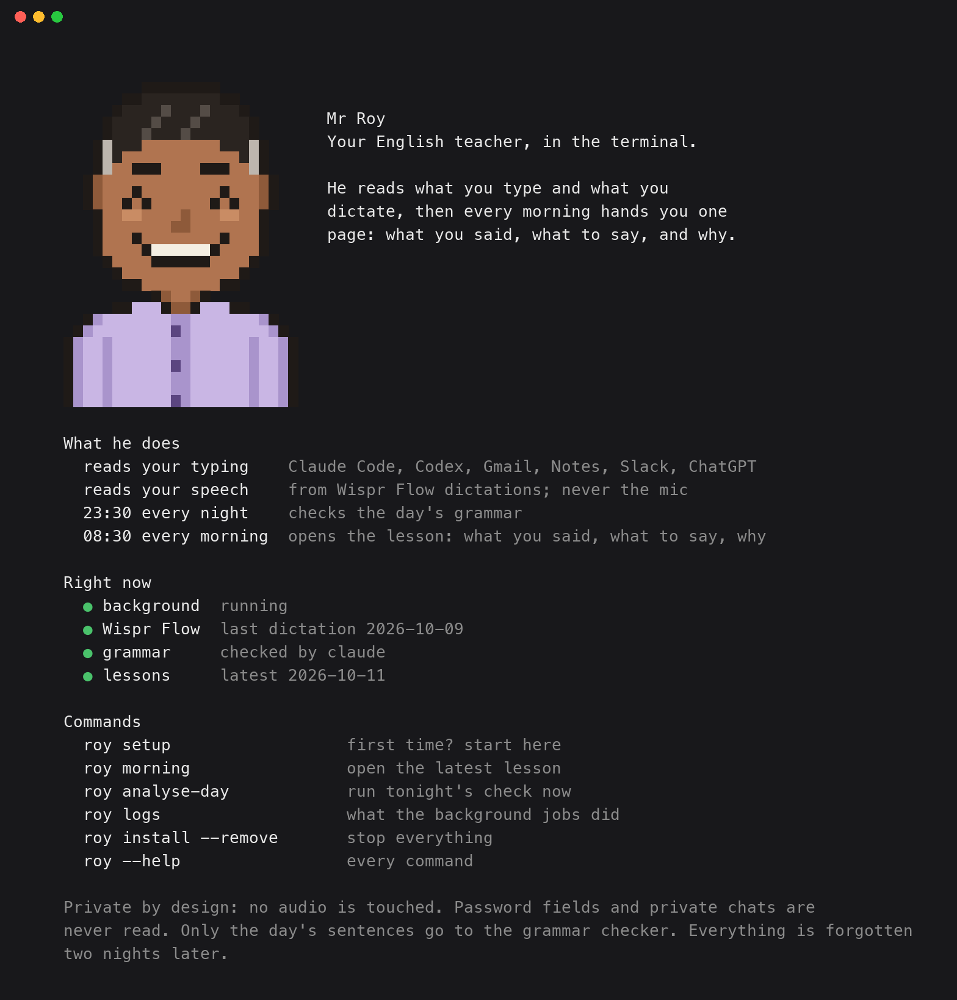

<div align="center">


# Mr Roy

**An English teacher who reads how you write and what you dictate, then hands you a grammar lesson every morning.**

</div>

---

He reads what you type, in Gmail, Slack, Notes, ChatGPT or Claude Code, and
what you dictate through Wispr Flow. He marks the grammar a teacher would mark,
and at 08:30 a page opens on your desk: what you said, what to say instead,
and the one word that tells you why.

Every other English app makes you sit down and practise. This one grades how
you actually wrote and spoke yesterday. It corrects grammar, never Indian
English: "prepone", "do the needful" and "this side Baibhav" are not mistakes.

macOS. He never opens your microphone and never touches audio.

> **AGREEMENT**
> You said ~~"the people that is actually building"~~
> Say **"the people that are actually building"**
> *plural noun requires plural verb*
> &nbsp;&nbsp;&nbsp;&nbsp;"...find the people that is actually building and in consumer AI startup..."

## What you need

- **A Mac** and **Python 3.10 or newer** (`python3 --version`). The Mac's own
  Python is 3.9; get a newer one from python.org or with `brew install python`.
- **Claude Code or Codex**, installed and logged in. The grammar check runs
  through it once a night, on your own plan; nothing else to pay for.
- **Wispr Flow** (optional). It is where he reads what you say. Without it
  you get lessons from your typing only.

## Install

```bash
git clone https://github.com/ajmerabaibhav/Mr-Roy.git mr-roy
cd mr-roy && python3 -m venv .venv && source .venv/bin/activate
pip install -e . && roy setup
```

To have `roy` in every new terminal, add `~/mr-roy/.venv/bin` to your PATH.
Everything he saves (`data/`, `reports/`, `logs/`) goes in `~/mr-roy`
wherever you cloned the code; set `MR_ROY_HOME` to put it elsewhere.

`roy setup` checks the machine, says what he reads, starts three
background jobs and asks macOS for Accessibility. One dependency (PyObjC's
Accessibility bindings), no model download. Then type and dictate normally. That is the whole interaction.

- **What he reads.** Your Wispr Flow dictations, what you type into Claude
  Code and Codex chats (from their own history on your Mac), and, with
  Accessibility, the box you are typing in anywhere else (Gmail, Notes,
  Slack). Once a night the day's sentences go to your Claude Code or Codex
  CLI for the grammar check.
- **Grammar checker.** Setup checks that Claude Code or Codex is installed
  and signed in (`claude auth status`, `codex login status`), and says how to
  fix it if not. Without one, only a few local rules run.
- **Accessibility.** The background job runs inside a small app,
  `Mr Roy.app` (built on your Mac from `mr_roy/native/launcher.c`,
  with his portrait as its icon), so macOS asks for **Mr Roy**, not
  Python. Setup opens System Settings at the right page and waits; switch on
  Mr Roy and setup says so within seconds. Skip it and Wispr and the
  chats still work; switch it on later and he picks it up within 10 minutes.
  No Xcode command line tools? He runs as plain Python and macOS names that
  instead.

## A day with him

1. **All day** you type and dictate as usual. He reads quietly in the background.
2. **23:30** he checks the day's grammar: what you wrote, and what you said
   into Wispr Flow.
3. **08:30** a page opens in your browser: each mistake, the correct version,
   and one word on why.

Type `roy` on its own any time to see what he does and what is running:



## What he reads

| source | what it gives him |
|---|---|
| **Wispr Flow's database** | your dictation, in any app. Its raw transcript keeps your mistakes; its cleaned text has already fixed them, so it is used only to tell a mishearing from a slip. Text only, read from a read-only copy. |
| **Claude Code and Codex** | what you typed, from their own history. Pastes, commands and tool output excluded. |
| **The text box you are typing in** | Mail, Slack, ChatGPT, Notes, a browser. Read through Accessibility like a screen reader, never keystrokes. Never reads password fields, single-line boxes (URL bars, search, logins), password managers, terminals or private chats, and nothing at all while macOS Secure Input is on. Pastes are dropped; emails, links and long numbers are scrubbed before they are saved. Off until you allow it under Accessibility (see Install). |

## How it works, for the curious

```
the day's sentences   Wispr's raw transcripts + what you typed
        ↓
a few local rules      certain, free, never have an off night
        +
one pass a night      batched calls to the CLI already installed here:
                       Claude Code (Haiku 5.5), or Codex (gpt-6-luna) if that is what you have
        ↓
every correction must quote a span that is really in your text, or it is
dropped. Nothing else stands between you and an invented mistake.
```

## Commands

| | |
|---|---|
| `roy` | who he is, what he does, and what is running right now |
| `roy listen` | the background job: reads your typing. Never opens the microphone |
| `roy analyse-day` | run tonight's job now |
| `roy morning` | open the latest lesson |
| `roy logs` | what the scheduled jobs actually did |
| `roy install --status` | are the three agents really running |
| `roy install --remove` | stop all of it (saved lessons stay until you delete `data/` and `reports/`) |

## What he will not claim

- **No pronunciation.** An earlier version scored your sounds from Wispr's
  audio. It was never shown to be right on a real voice, so it was removed
  rather than shipped as a guess.
- **He never opens the microphone, so meetings are never heard.** Speech
  comes only from Wispr Flow, when you choose to dictate.
- **He can miss things.** On 16 real sentences (`tests/grammar_eval.py`) he
  caught 9 or 10 of the 10 errors on three runs of the nightly single pass
  and marked none of the 6 Indian English traps, but a
  quiet page means "nothing he could prove", not "perfect English".
- **Text leaves the machine once a night** for the grammar call.
  It uses the Claude Code CLI, or OpenAI's Codex CLI if that is what you have
  (`MR_ROY_LLM=codex` to choose it when both are installed).
  `MR_ROY_NO_LLM=1` turns that off and falls back to local rules.
  Set these before `roy setup` (or re-run `roy install` after changing them):
  the background jobs keep what was set then.
  To keep that text out of model training, on a personal plan turn off "Help improve Claude" at
  claude.ai/settings/data-privacy-controls, or "Improve the model for
  everyone" in ChatGPT → Settings → Data controls (it covers Codex too).
  Work, team and API accounts are not trained on by default.

## Privacy

No audio is read or stored. Everything stored about a day (the report, its
corrections, what you typed) deletes itself two nights later: Monday's data
is gone on Wednesday night. He never opens the microphone. Typed text is read only from multi-line text boxes, never from
password fields, password managers, terminals or private chats, and emails,
links and long numbers are scrubbed before it is saved. `data/`,
`reports/` and `logs/` are gitignored; this repo contains no one's sentences
but the example above and the author's own 16 test sentences in
`tests/grammar_eval.py`.

## Tests

```bash
pip install -e '.[dev]' && python3 -m pytest tests -q
```

---

What changed and what was measured: [CHANGELOG.md](CHANGELOG.md).
What is still broken: [TODOS.md](TODOS.md). MIT.
